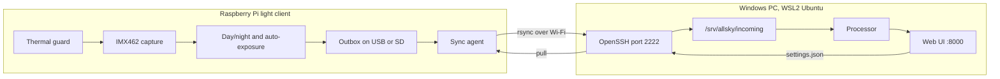

# allsky-web v1.14.0

A full fork of the [Allsky](https://github.com/AllskyTeam/allsky) sky camera project with a modern, mobile-first web interface. No PHP, no lighttpd — just FastAPI + React.

**One install, everything works.** Camera capture backend + modern web UI.

## Quick start

```bash
git clone https://github.com/mucoucah/allsky.git
cd allsky
sudo ./install.sh
```

Open `http://<your-pi-ip>:8000` — the setup wizard walks you through camera detection and configuration. The installer asks for a web UI password (or generates one and prints it). No terminal needed after install.

## Hardware

This tree is set up for a night meteor camera on a Raspberry Pi that previously overheated:

- Raspberry Pi 4B, 4 GB
- Arducam industrial camera, Sony STARVIS IMX462 color, 2 MP (1920×1080), fisheye lens
- Driver: the Bullseye or Bookworm libcamera / rpicam-still driver already in Raspberry Pi OS (the IMX462 uses the imx290 overlay)
- Cooling: a heatsink plus a 5 V fan, or a fan case. Use a vented, shaded enclosure and keep the Pi outside the sealed dome
- Power: the official 5 V 3 A supply

Night defaults (milliseconds for exposure and delay; gain is the libcamera linear factor):

| Setting | Value | Why |
| --- | --- | --- |
| Manual night exposure | 8 s | Long enough for meteors, short enough to keep the sensor and the Pi moving |
| Max auto exposure | 10 s | Auto mode cannot run away to a minute-plus exposure |
| Night gain | 16 | About 24 dB. The IMX462 analogue ceiling is **29.4 dB ≈ 29.51×** (`10^(0.015 × gain_code)`, codes 0–98 at 0.3 dB). Higher `--analoggain` values are accepted and the extra is ISP digital gain, which mostly amplifies noise |
| Max auto gain | 29 | Stays inside that analogue range |
| Night delay | 0.5 s | The next frame starts quickly |

`rpicam-still` / `libcamera-still` is started with `--immediate` when Allsky is setting the shutter itself, so the process does not sit in a preview waiting for auto-exposure to settle. A single long-lived camera process would avoid the per-frame startup cost; that is a follow-up, not this change.

## Meteor detection

Enable it under Sky Monitor. It runs only at night (latitude and longitude must be set). Each new frame, not a 15-minute timer, is checked on a worker thread:

1. Grayscale copy, downscaled 2×, with the mask applied (painted areas are ignored).
2. Subtract the previous frame, or a short running median, so stars and static edges drop out.
3. Drop a streak that is still bright on the previous frame or continues a line from that frame (planes and satellites that last more than one exposure).
4. Save a hit as the full frame, a crop, and a small JSON file (line coordinates and time) under `html/allsky/meteors/<date>/`.
5. Send an alert at most once per cooldown (default 10 minutes), not once per day.

While the CPU is warm the focus and rain watchers, overlays, and mini-timelapse pause. Meteor detection itself keeps running until capture is stopped for heat.

## Features

### Camera & imaging
- **Live view** via WebSocket push (no polling)
- **Setup wizard** — auto-detects RPi/ZWO cameras, configures, starts capture
- **Image gallery** with date filtering, EXIF metadata, lightbox
- **Keograms & startrails** viewer with full-screen overlay
- **Dark frame management** — capture, list, download, delete dark frames by temperature
- **Regenerate** keograms, startrails, and timelapse videos for any past date

### Dashboard & system
- **Dashboard** with CPU temp, disk, memory, camera status, focus quality, start/stop buttons
- **Throttle history** — tracks and displays CPU thermal throttling events
- **System control**: start/stop/restart camera, reboot/shutdown, log viewer — all from the browser
- **Version checker** — compares installed vs. latest release for both camera backend and web UI

### Settings & overlays
- **Settings editor** with validation, dependency awareness, audit trail
- **Visual overlay editor** — drag fields, set font size/color/stroke, per-layout configs
- **Visual mask editor** (Konva) with draw/erase, undo/redo

### Detection & monitoring
- **Meteor/streak detection** with configurable sensitivity
- **Focus monitoring** with calibration and cloud-proof hysteresis
- **Rain/moisture detection** — analyzes bright blobs, contrast, and local variance on the dome with confidence scoring

### Aircraft tracking (ADS-B)
ADS-B and the satellite watcher both start **disabled**. Leave them off on a Pi 4 unless the CPU stays cool; each one is extra network and CPU work during the night.
- **OpenSky Network integration** — fetches nearby aircraft positions in real-time
- Computes distance, bearing, and elevation angle relative to camera location
- **Emergency squawk detection** (7500 hijack, 7600 radio failure, 7700 emergency)
- **Aircraft metadata enrichment** — registration (tail number), aircraft type, operator via background API lookups (cached 24h)
- Extra state vector data: position source (ADS-B/MLAT badge), aircraft category (Light/Medium/Heavy/Rotorcraft/UAV), vertical rate, SPI flag
- **Configurable alert triggers**: emergency squawk, all flights, low altitude, slow movers, no callsign — each independently toggleable

### Satellite pass prediction
- **CelesTrak TLE integration** — downloads orbital elements for ISS, Starlink, Hubble, and other bright satellites (free, no API key)
- **Local pass computation** using `ephem` — rise/set times, max elevation, duration, sunlit visibility check
- **Configurable satellite groups**: space stations, bright visual satellites, Starlink constellation
- **Alert triggers**: ISS passes, any space station, bright passes (>45° elevation), Starlink, all visible — each independently toggleable with configurable lead time and cooldown
- **Dashboard card** showing next upcoming pass
- Currently-overhead satellite display with real-time positions

### Alerts & notifications
- **Multi-channel dispatch**: Telegram, Discord, Email, ntfy.sh, webhook
- Per-channel attachment options (snapshot, timelapse)
- **Persistent alert log** with acknowledgment tracking and severity levels
- **Rate limiting and cooldowns** per alert type to prevent spam

### Security
- **Session authentication is on by default.** The installer prompts for a password or generates one and prints it once. Set `ALLSKY_WEB_AUTH=0` in `/etc/allsky-web/env` only on a trusted LAN
- bcrypt password hashing
- **Upload testing** — validate remote-web, remote-server, and local-web upload configurations

## What the installer does

1. Installs OS packages (Python 3, Node.js, OpenCV, libcamera, fonts)
2. Compiles the Allsky capture binary (`src/`)
3. Builds `sunwait` sunrise/sunset calculator
4. Creates Python venv for Allsky's overlay modules (Pillow, ephem, astral, etc.)
5. Creates Python venv for the web backend (FastAPI, uvicorn, httpx, etc.)
6. Builds the React frontend (Vite + Tailwind)
7. Copies overlay templates, module pipeline configs, and fonts
8. Sets up `allsky.service` and `allsky-web.service` as systemd units
9. Configures sudoers for service control, reboot, and camera detection
10. Starts everything and prints the URL

**First install: ~15 minutes** on a Pi 3B.

## Architecture

```
allsky.sh, scripts/, src/     # camera capture pipeline (C++ binary + bash)
backend/                      # FastAPI + uvicorn (single web server, no PHP/lighttpd)
  app/allsky/                 # filesystem adapters (images, settings, logs)
  app/notify/                 # meteor detector, focus analyzer, rain detector,
                              # ADS-B tracker, satellite predictor, notification channels
  app/routers/                # REST + WebSocket endpoints (auth, settings, images,
                              # system, maintenance, notifications, alerts)
frontend/                     # React + Tailwind + Konva
  src/routes/                 # Dashboard, Gallery, Settings, OverlayEditor,
                              # MaskEditor, Notifications, Maintenance, Alerts, etc.
html/allsky/                  # artefact dirs (keograms, startrails, videos — populated at runtime)
config_repo/                  # default overlay templates, module pipeline configs
```

## Configuration

All configuration is done through the web UI. Advanced settings in `/etc/allsky-web/env`:

| Variable | Default | Description |
|----------|---------|-------------|
| `ALLSKY_HOME` | *(auto-detected)* | Path to allsky installation |
| `ALLSKY_WEB_HOST` | `0.0.0.0` | Listen address |
| `ALLSKY_WEB_PORT` | `8000` | Listen port |
| `ALLSKY_WEB_AUTH` | `1` | Set to `0` to disable the login |
| `ALLSKY_WEB_USER` | `admin` | Username for auth |
| `ALLSKY_WEB_PASS_HASH` | *(set by installer)* | bcrypt hash of the password |
| `ALLSKY_WEB_FORWARDED_ALLOW_IPS` | *(unset)* | Reverse-proxy address allowed to set X-Forwarded-*. `*` is ignored |
| `ALLSKY_WEB_SECRET` | *(auto-generated)* | Session signing key |
| `ALLSKY_WEB_CONFIG` | *(set by installer)* | Path to web config directory |
| `ALLSKY_WEB_DATA` | `/var/lib/allsky-web` | Data directory for alert DB, notification configs |

## Offload processing to a PC

Use this when the Pi should stay cool. The Pi captures and buffers. A Windows PC does meteor detection, keograms, startrails, timelapse, and the web UI. Normal mode is unchanged: if `config/offload.json` is missing or `"mode"` is `"normal"`, the Pi still runs overlays, ImageMagick, the module pipeline, and end-of-night products.



The web UI runs on the PC, against the processed tree in `/srv/allsky/data`. Do not run a UI server on the Pi in the light profile. The dashboard reads a heartbeat the Pi uploads (CPU temperature, throttle bits, disk free, outbox size, last frame time, last camera error). Camera settings saved in that UI are written to `/srv/allsky/to-pi/` and the Pi installs them on its next successful sync, then restarts capture.

### Bandwidth

A 1920×1080 JPEG at quality 90 of a night sky is about 250–700 KB. Use 500 KB as the planning number. The night profile takes an 8 s exposure and then waits 0.5 s, so a frame leaves the camera about every 8.5 s.

500 KB × 8 bits / 8.5 s is about 0.5 Mbit/s. A busy field closer to 800 KB is still under 1 Mbit/s. That is the sustained rate while the PC is awake. A backlog is larger: 8 hours offline is about 3,400 frames, roughly 1.7 GB. With the suggested 2000 kbps cap (250 KB/s) that backlog takes around two hours, and night frames are sent before day frames.

A 4 GB outbox holds on the order of 8,000 frames, about 19 hours at this cadence, before the oldest files are deleted. Day frames are deleted first when night frames have priority.

### Pi

1. Flash Raspberry Pi OS Lite. Do not install a desktop.
2. From this repo: `sudo ./install.sh --light`
3. The light profile installs libcamera, the capture binary, sunwait, a thermal guard, and the sync agent. It does not install Node, the web UI, ffmpeg, ImageMagick, or Python OpenCV. The capture program still links the system libopencv library because it re-reads each JPEG to compute the auto-exposure mean.
4. Edit `config/offload.json`. Set `remote.host` to the PC's LAN address, `remote.port` to `2222`, `remote.user` to `allsky`, `remote.ssh_key`, and `remote.path` to `/srv/allsky/incoming`. `mode` is already `capture-only`. `jpeg_quality` defaults to 90 and is passed to libcamera as `--quality`. Point `outbox_dir` at a USB disk if you have one; otherwise it stays on `/var/lib/allsky/outbox`. `image.jpg` is the only frame kept on the tmpfs at `tmp/`.
5. Create a key and install it for the PC's `allsky` user (after the PC steps below):

```bash
ssh-keygen -t ed25519 -f ~/.ssh/allsky_offload -N ""
ssh-copy-id -i ~/.ssh/allsky_offload.pub -p 2222 allsky@<pc-lan-ip>
```

6. `sudo systemctl enable --now allsky allsky-sync allsky-thermal allsky-wifi-powersave`

Wi-Fi power save is a common cause of stalled SSH on a Pi. The installer enables `allsky-wifi-powersave.service`, which runs `iw dev wlan0 set power_save off`. Check with `iw dev wlan0 get power_save`.

Heat, applied only if you want it:

```bash
sudo ./offload/pi/pi-heat.sh --governor ondemand
sudo ./offload/pi/pi-heat.sh --governor powersave --disable-bt --disable-leds
sudo ./offload/pi/pi-heat.sh --disable-hdmi
```

`--disable-hdmi` blanks the display. `--disable-bt` adds `dtoverlay=disable-bt` and needs a reboot. Leave Wi-Fi enabled. `powersave` is the cooler governor; `ondemand` is the one to keep if capture starts to lag.

### Windows PC and WSL2

The robust path on Windows 11 is mirrored networking. WSL then uses the PC's LAN address, so that address does not change when WSL restarts. A port proxy to the old NAT address breaks every time the PC sleeps.

1. In Windows, `wsl --install -d Ubuntu` if Ubuntu is not there yet. In `/etc/wsl.conf` inside Ubuntu:

```ini
[boot]
systemd=true
```

In `C:\Users\<you>\.wslconfig`:

```ini
[wsl2]
networkingMode=mirrored
```

Then `wsl --shutdown` from Windows and open Ubuntu again.

2. Do not install a Linux NVIDIA driver inside WSL. Driver 560.94 on Windows already provides CUDA and NVENC to WSL (`nvidia-smi` inside Ubuntu should print the TITAN Xp). `opencv-python-headless` from pip is a CPU build. The processor calls `cv2.cuda` when that build actually has a device, and otherwise runs the same detector on the CPU. A 2 MP frame every 8.5 s is a light load for the i7-7700 either way. Timelapse uses `h264_nvenc` or `hevc_nvenc` through ffmpeg, and falls back to `libx264`.

3. In the Ubuntu repo checkout: `sudo ./offload/processor/install-wsl.sh`

That installs ffmpeg and OpenSSH, a processor venv, the web UI venv, `/srv/allsky/incoming`, `/srv/allsky/to-pi`, and `/srv/allsky/data`. sshd listens on port 2222 and refuses passwords. The processor and the web UI run as the `allsky` user under systemd.

4. Allow TCP 2222 and TCP 8000 through the Windows firewall. In an elevated PowerShell:

```powershell
New-NetFirewallRule -DisplayName "Allsky WSL SSH" -Direction Inbound -Protocol TCP -LocalPort 2222 -Action Allow
New-NetFirewallRule -DisplayName "Allsky Web" -Direction Inbound -Protocol TCP -LocalPort 8000 -Action Allow
```

Mirrored mode also has a Hyper-V firewall. If the Pi cannot connect after the rule above, add the matching Hyper-V rule for TCP 2222 (`New-NetFirewallHyperVRule` on current Windows 11) or temporarily set the Hyper-V VM default inbound action to Allow and confirm the port is the one that was blocked.

5. Put the Pi's public key in `/home/allsky/.ssh/authorized_keys`.

6. Build the frontend if the installer did not (it needs Node 20): `cd frontend && npm install && npm run build`, then copy `dist` to `/opt/allsky-web/frontend/dist`. Open `http://<pc-lan-ip>:8000`.

7. On the System page, confirm capture-only, the incoming path, and JPEG quality, then save. That writes `/srv/allsky/to-pi/offload-push.json`. Camera settings saved on the Settings page are copied to `/srv/allsky/to-pi/settings.json`. The Pi pulls both. The SSH host and key are not overwritten by that push; those stay in the Pi's own `config/offload.json`.

Windows 10 has no mirrored mode. Use `offload/processor/windows-portproxy.ps1` from an elevated PowerShell after each WSL start. It forwards `0.0.0.0:2222` to the current WSL address and adds the firewall rule. Schedule it at logon, because the NAT address changes.

### Verify

On the Pi:

```bash
python3 offload/mode.py
ls -lh /var/lib/allsky/outbox
journalctl -u allsky-sync -u allsky-thermal -n 50
```

`mode.py` prints `capture-only`. After a frame, the outbox has names like `N_20261117_20261117_220015.jpg`. `tmp/image.jpg` is the only full-size preview on the tmpfs.

On the PC:

```bash
nvidia-smi
ffmpeg -hide_banner -encoders | grep nvenc
systemctl status allsky-processor allsky-web ssh
ls /srv/allsky/incoming
```

A frame should leave `incoming` and show up under `/srv/allsky/data/images/<date>/`. The dashboard "Camera Pi" card shows temperature and the last frame time. Turn meteor detection on under Sky Monitor so a saved hit also sends an alert. At the end of the night the processor writes `images/<date>/keogram/`, `images/<date>/startrails/`, and `images/<date>/allsky-<date>.mp4`.

### When the PC is off or asleep

The Pi keeps capturing. Frames stay in the outbox. The sync agent retries with backoff from 5 seconds up to 5 minutes. rsync uses `--partial` and `--append-verify`, so a dropped transfer resumes, and `--remove-source-files` deletes a local file only after that file has been confirmed on the PC. If the outbox crosses `outbox_max_bytes`, the oldest day frames are deleted first and a warning is logged. Night frames are deleted only after the day frames are gone.

Nothing on the PC runs while it is asleep, so there are no live meteor alerts and no end-of-night products until it wakes and the backlog is processed. Products for a night are built once day frames arrive and the night has been quiet for 5 minutes, or after 45 minutes of quiet if day frames were dropped, or as soon as the next night's frames show up.

### Limitations

- The PC has to be on for live meteor alerts. Hits that arrive while it is asleep are still detected when the frames are processed, and the web UI alerts only for hits that appear after it has started.
- The pip OpenCV wheel does not include `cv2.cuda`. NVENC still works from the Windows driver. A CUDA OpenCV build is optional; the CPU path is the one this i7 will use unless you replace the wheel.
- WSL does not keep running while Windows is asleep. Mirrored networking needs Windows 11. The port-proxy fallback must be refreshed when the WSL address changes.
- Start/stop on the PC System page controls a local `allsky.service`, which the PC does not have. Capture is restarted on the Pi when pulled settings change.
- Dark-frame capture and the on-Pi overlay editor belong to normal mode. The light profile has no ImageMagick and no web server.
- Switching a light-client Pi back to `normal` will fail the usual pipeline, because those packages were not installed.

## License

GPL-3.0 (same as upstream Allsky)
